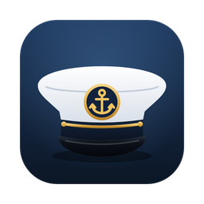
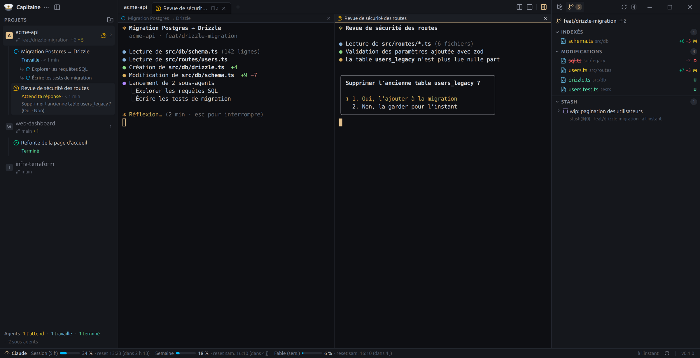
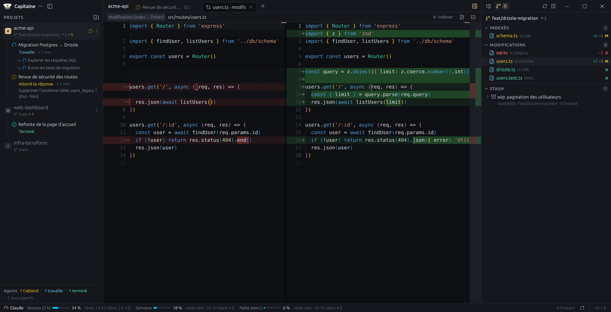
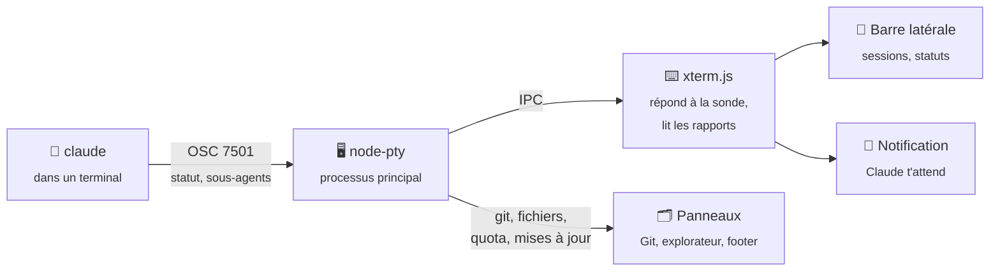

<div align="center">



# Capitaine

### Garde le cap sur tes agents IA.

**L'espace de travail IA-first pour piloter tes sessions Claude Code, projet par projet.**<br />
Terminaux côte à côte, statut de chaque agent en direct, fichiers, git et quota : tout dans une seule fenêtre.

[](https://github.com/lucas-burlot/Capitaine/releases/latest)
[](LICENSE)
[](#-télécharger)
[](#-suivi-des-agents-sans-configuration)
[](#-pourquoi-capitaine)
[](https://www.electronjs.org)
[](https://github.com/lucas-burlot/Capitaine/stargazers)

[**Télécharger**](#-télécharger) · [**Fonctionnalités**](#-fonctionnalités) · [**Comment ça marche**](#-comment-ça-marche) · [**FAQ**](#-faq) · [**Roadmap**](#%EF%B8%8F-roadmap)

<br />



</div>

<br />

> **Trois agents qui travaillent, c'est trois fois plus d'onglets à surveiller.** Lequel a fini ? Lequel attend ta réponse depuis dix minutes ?
> Capitaine te le dit en un coup d'œil, et te prévient quand on a besoin de toi.

## 💡 Pourquoi Capitaine

Lancer plusieurs Claude Code en parallèle est puissant, mais un terminal classique ne te dit rien de ce qu'ils font. Capitaine garde tes sessions rangées par projet et affiche leur état en direct, **sans hook ni configuration** : tu lances `claude`, c'est tout.

|  | **Capitaine** | Terminal + éditeur classiques |
| :--- | :---: | :---: |
| **Qui travaille, qui t'attend** | ✅ en direct, par projet | ❌ fouiller les onglets |
| **Sous-agents en cours** | ✅ listés sous leur session | ❌ |
| **Alerte quand Claude t'attend** | ✅ notification système | ❌ |
| **Terminaux par projet, côte à côte** | ✅ | ⚠️ à organiser soi-même |
| **Fichiers modifiés par l'agent, diffs** | ✅ dans la même fenêtre | ⚠️ un autre outil |
| **Quota Claude (5 h, semaine)** | ✅ toujours visible | ❌ `/usage` à la main |
| **Configuration** | ✅ aucune | — |
| **Prix** | **Gratuit, open source** | — |

## ✨ Fonctionnalités

<table>
<tr>
<td width="50%" valign="top">

### 🧭 Tes agents en un coup d'œil
Sous chaque projet, la liste de tes sessions Claude : leur nom, leurs **sous-agents**, et leur statut en direct (*Travaille*, *Attend ta réponse*, *Attend ta permission*, *Terminé*), avec le texte de la question en attente.

</td>
<td width="50%" valign="top">

### 🔔 Prévenu au bon moment
Une notification système quand un agent t'attend ou a fini, sauf si tu regardes déjà son terminal. Un clic et tu y es.

</td>
</tr>
<tr>
<td valign="top">

### 🪟 Terminaux côte à côte
Des onglets par projet, que tu divises à droite ou en bas autant que tu veux. Les shells restent vivants quand tu changes d'onglet ou de projet : tes agents continuent de travailler. Ferme l'app et rouvre-la : tes onglets reviennent, chaque terminal dans le dossier où tu l'avais laissé, avec son historique, et tes sessions Claude reprennent leur conversation (`claude --resume`).

</td>
<td valign="top">

### 🌳 Explorateur de fichiers
L'arborescence du projet, rafraîchie toute seule, colorée selon git. **Retrouve n'importe quel fichier** en tapant quelques lettres de son nom (`⌘P` / `Ctrl+Shift+P`), et **glisse-le dans un terminal** pour donner son chemin à Claude.

</td>
</tr>
<tr>
<td valign="top">

### 🔀 Git, de la branche au push
Le panneau Git montre ce qui est modifié, indexé ou en conflit, avec les lignes ajoutées et supprimées. **Change de branche ou crée-en une** depuis le sélecteur, **commite, pousse et récupère** (pull, sync) sans quitter l'app. Le ✨ fait **écrire le message de commit par Claude**, dans le style de tes commits. En cas de conflit, **Claude propose une résolution** que tu relis (et retouches) dans un diff avant de l'accepter.

</td>
<td valign="top">

### 📝 Éditeur intégré
Double-clic sur un fichier : il s'ouvre dans Monaco, l'éditeur de VS Code. Si un agent le modifie pendant que tu le lis, il se recharge tout seul.

</td>
</tr>
<tr>
<td valign="top">

### 📊 Ton quota Claude
La session de 5 h, la semaine et les quotas par modèle, avec l'heure de remise à zéro, en bas de la fenêtre.

</td>
<td valign="top">

### 🔄 Toujours à jour
Une carte t'annonce chaque nouvelle version, avec ses nouveautés. Tu choisis quand la télécharger et l'installer, et ta version reste affichée dans le footer.

</td>
</tr>
</table>

<div align="center">
<br />

<sub><b>Ce que l'agent a changé, ligne par ligne.</b> Un clic dans le panneau Git.</sub>
</div>

## 🧭 Suivi des agents, sans configuration

Claude Code (version 2.1.295 et plus) sait annoncer son état au terminal qui l'héberge, via le *Program Status Protocol* (OSC 7501). Capitaine répond à sa sonde, puis lit ce qu'il annonce :

| Ce que fait Claude | Ce que tu vois |
| :--- | :--- |
| Travaille sur ta demande | ⟳ **Travaille** · depuis combien de temps |
| Lance des sous-agents | ↳ un sous-agent par ligne, sous la session |
| Te pose une question | ❓ **Attend ta réponse**, avec la question et les choix |
| Demande une permission | 🛡️ **Attend ta permission** |
| A fini son tour | ✅ **Terminé** |
| Est fermé (`/exit`) | La session disparaît de la liste |

Le nom de la session vient du titre que Claude donne à la conversation. Si Claude s'arrête brutalement, Capitaine s'en rend compte dès que le shell reprend la main (macOS, Linux).

## 📥 Télécharger

| Plateforme | Fichier |
| :--- | :--- |
| 🍏 **macOS** · Apple Silicon (M1 et plus) | [**Capitaine-mac-arm64.dmg**](https://github.com/lucas-burlot/Capitaine/releases/latest/download/Capitaine-mac-arm64.dmg) |
| 🍏 **macOS** · Intel | [**Capitaine-mac-x64.dmg**](https://github.com/lucas-burlot/Capitaine/releases/latest/download/Capitaine-mac-x64.dmg) |
| 🪟 **Windows** 10 / 11 | [**Capitaine-win-x64.exe**](https://github.com/lucas-burlot/Capitaine/releases/latest/download/Capitaine-win-x64.exe) |
| 🐧 **Linux** | [**.deb**](https://github.com/lucas-burlot/Capitaine/releases/latest/download/capitaine-linux-amd64.deb) (Ubuntu, Debian) · [**AppImage**](https://github.com/lucas-burlot/Capitaine/releases/latest/download/Capitaine-linux-x86_64.AppImage) |

Toutes les versions et leurs notes : [**Releases**](https://github.com/lucas-burlot/Capitaine/releases). Tu préfères compiler toi-même ? Voir [Lancer depuis les sources](#-démarrage-rapide).

<details>
<summary><b>⚠️ Premier lancement : les applications ne sont pas encore signées</b></summary>

<br />

Capitaine est gratuit et n'a pas (encore) de certificat Apple ou Microsoft, donc ton système te prévient la première fois :

- **macOS** : ouvre le `.dmg` et glisse Capitaine dans *Applications*. Au premier lancement, macOS dit ne pas pouvoir vérifier le développeur : ouvre *Réglages Système → Confidentialité et sécurité*, descends et clique sur **Ouvrir quand même**. (Ou lance une fois `xattr -dr com.apple.quarantine /Applications/Capitaine.app`.)
- **Windows** : SmartScreen affiche *« Windows a protégé votre ordinateur »* : clique sur **Informations complémentaires → Exécuter quand même**.
- **Linux** : `sudo apt install ./capitaine-linux-amd64.deb`. Sur Ubuntu, préfère le `.deb` à l'AppImage : son installation configure le sandbox de Chromium.

</details>

## 🚀 Démarrage rapide

1. **Ajoute un projet** : le bouton 📁+ de la barre latérale, puis le dossier de ton code.
2. **Ouvre un terminal** : il démarre dans le dossier du projet, avec ton shell habituel.
3. **Lance `claude`**. La session apparaît sous le projet, avec son statut. 🎉

Divise l'onglet pour lancer un deuxième agent à côté, et ouvre le panneau de droite pour voir les fichiers et les changements git.

<details>
<summary><b>🧑‍💻 Lancer depuis les sources</b></summary>

<br />

Il faut [Node.js](https://nodejs.org) 22 ou plus. Sur Linux, `python3`, `make` et `g++` aussi (pour compiler `node-pty`).

```bash
git clone https://github.com/lucas-burlot/Capitaine.git
cd Capitaine
npm install
npm run dev
```

**Ubuntu 23.10 et plus** : si le lancement échoue avec *« The SUID sandbox helper binary was found, but is not configured correctly »*, donne à `chrome-sandbox` les droits qu'attend Electron (à refaire après chaque réinstallation d'Electron) :

```bash
sudo chown root:root node_modules/electron/dist/chrome-sandbox
sudo chmod 4755 node_modules/electron/dist/chrome-sandbox
```

Pour l'installer comme une vraie application : `npm run dist:linux` puis `sudo apt install ./dist/capitaine-linux-amd64.deb` (ou `dist:mac`, `dist:win`, chacun sur son système).

</details>

## ⌨️ Raccourcis

| Action | macOS | Windows / Linux |
| :--- | :---: | :---: |
| Nouvel onglet | <kbd>⌘</kbd> <kbd>T</kbd> | <kbd>Ctrl</kbd> <kbd>Shift</kbd> <kbd>T</kbd> |
| Fermer le terminal ou l'onglet | <kbd>⌘</kbd> <kbd>W</kbd> | <kbd>Ctrl</kbd> <kbd>Shift</kbd> <kbd>W</kbd> |
| Diviser à droite | <kbd>⌘</kbd> <kbd>D</kbd> | <kbd>Ctrl</kbd> <kbd>Shift</kbd> <kbd>D</kbd> |
| Diviser en bas | <kbd>⌘</kbd> <kbd>⇧</kbd> <kbd>D</kbd> | <kbd>Ctrl</kbd> <kbd>Shift</kbd> <kbd>E</kbd> |
| Panneau suivant / précédent | <kbd>⌘</kbd> <kbd>⌥</kbd> <kbd>→</kbd> / <kbd>←</kbd> | <kbd>Ctrl</kbd> <kbd>Alt</kbd> <kbd>→</kbd> / <kbd>←</kbd> |
| Onglet suivant / précédent | <kbd>⌘</kbd> <kbd>⇧</kbd> <kbd>]</kbd> / <kbd>[</kbd> | <kbd>Ctrl</kbd> <kbd>Tab</kbd> / <kbd>Ctrl</kbd> <kbd>Shift</kbd> <kbd>Tab</kbd> |
| Ajouter un projet | <kbd>⌘</kbd> <kbd>O</kbd> | <kbd>Ctrl</kbd> <kbd>Shift</kbd> <kbd>O</kbd> |
| Barre latérale | <kbd>⌘</kbd> <kbd>⇧</kbd> <kbd>S</kbd> | <kbd>Ctrl</kbd> <kbd>Shift</kbd> <kbd>S</kbd> |
| Panneau de droite (fichiers, git) | <kbd>⌘</kbd> <kbd>B</kbd> | <kbd>Ctrl</kbd> <kbd>Shift</kbd> <kbd>B</kbd> |
| Enregistrer (éditeur) | <kbd>⌘</kbd> <kbd>S</kbd> | <kbd>Ctrl</kbd> <kbd>S</kbd> |
| Copier / coller (terminal) | <kbd>⌘</kbd> <kbd>C</kbd> / <kbd>V</kbd> | <kbd>Ctrl</kbd> <kbd>Shift</kbd> <kbd>C</kbd> / <kbd>V</kbd> |

Sur Windows et Linux, <kbd>Ctrl</kbd> + lettre reste au shell (<kbd>Ctrl</kbd> <kbd>C</kbd>, <kbd>Ctrl</kbd> <kbd>R</kbd>, <kbd>Ctrl</kbd> <kbd>W</kbd>…), d'où les raccourcis en <kbd>Ctrl</kbd> <kbd>Shift</kbd>.

## 🧠 Comment ça marche



Capitaine est construit avec **Electron**, **React** et **TypeScript**, sur le même socle qu'[Orca](https://github.com/stablyai/orca) : xterm.js, node-pty et Monaco. Les fichiers qui comptent :

| Fichier | Rôle |
| :--- | :--- |
| [`src/main/pty-manager.ts`](src/main/pty-manager.ts) | Les shells (node-pty) : création, sortie regroupée, processus au premier plan |
| [`src/renderer/src/agent-status.ts`](src/renderer/src/agent-status.ts) | Le parseur OSC 7501 et le modèle session / sous-agents |
| [`src/renderer/src/store.ts`](src/renderer/src/store.ts) | Projets, onglets, terminaux, agents |
| [`src/renderer/src/layout.ts`](src/renderer/src/layout.ts) | L'arbre de division des onglets (côte à côte, en bas) |
| [`src/main/source-control.ts`](src/main/source-control.ts) | Statut git, indexation, stash, contenu d'un fichier à une révision |
| [`src/main/git-actions.ts`](src/main/git-actions.ts) | Branches, commit, push, pull, fin de fusion / rebase, résolution de conflits |
| [`src/main/git-ai.ts`](src/main/git-ai.ts) | Message de commit et résolution de conflit écrits par Claude (via `claude -p`) |
| [`src/main/file-system.ts`](src/main/file-system.ts) | Listing des dossiers, surveillance des changements, lecture et écriture |
| [`src/renderer/src/editor/`](src/renderer/src/editor) | Monaco, chargé à la demande, et les sessions d'édition |
| [`src/main/claude-usage.ts`](src/main/claude-usage.ts) | Le quota Claude, via la connexion de Claude Code |
| [`src/main/updater.ts`](src/main/updater.ts) | Les mises à jour automatiques (releases GitHub) |
| [`src/main/menu.ts`](src/main/menu.ts) | Le menu et les raccourcis de chaque plateforme |

## 🔄 Mises à jour

Capitaine regarde au démarrage, puis toutes les 6 h, s'il existe une version plus récente sur GitHub, **sans rien télécharger**. Si oui, une carte apparaît en bas à droite, avec les nouveautés :

1. **Télécharger** : la mise à jour se télécharge pendant que tu continues à travailler ;
2. **Redémarrer maintenant**, ou **Au prochain lancement** : elle s'installera quand tu quitteras Capitaine.

*Plus tard* range la carte : la version reste signalée dans le footer, et un clic dessus la fait revenir.

En bas à droite, tu vois toujours **ta version** (`v0.1.1 · à jour`) ou celle **disponible** (`0.1.2 disponible`). Un clic sur ta version, ou le menu **⋯ → Aide → Rechercher les mises à jour…**, vérifie tout de suite.

> 💡 Sur macOS, l'installation automatique demande une app signée. En attendant, *Télécharger* ouvre la page de la nouvelle version sur GitHub.

## 🔒 Confidentialité

- **Pas de serveur Capitaine.** Il n'y a ni compte ni télémétrie.
- **Ton code reste chez toi.** L'interface ne peut lire que les dossiers de tes projets.
- **Le quota Claude** passe par la connexion de Claude Code (trousseau macOS ou `~/.claude/.credentials.json`). Le jeton reste dans le processus principal, n'est envoyé qu'à `api.anthropic.com` et n'est jamais renouvelé par Capitaine.
- **Les mises à jour** interrogent uniquement les releases GitHub de ce dépôt.
- **Les fonctions IA du panneau Git** (message de commit ✨, résolution de conflit) ne partent que quand tu cliques. Elles passent par ta CLI Claude Code (`claude -p`, sans outils) et envoient à Anthropic le diff à décrire ou le fichier en conflit, comme le ferait une session Claude Code.
- **Tes projets** sont enregistrés dans un simple fichier local (`projects.json`, dans le dossier de données de l'app).

## 🗺️ Roadmap

- [x] Projets, terminaux par projet et divisions côte à côte
- [x] Suivi des sessions Claude Code et de leurs sous-agents, notifications
- [x] Explorateur de fichiers avec statut git, recherche de fichier et glisser-déposer vers les terminaux
- [x] Éditeur intégré (Monaco), rechargé quand un agent modifie le fichier
- [x] Panneau Git : changements, index, diffs et stash
- [x] Quota Claude dans le footer
- [x] Installeurs macOS, Windows, Linux et mises à jour automatiques
- [x] Branches, commit, push, pull et sync depuis le panneau Git, message de commit et résolution de conflits par Claude
- [ ] Annulation de modifications et actions sur les stash depuis le panneau Git
- [ ] Éditeur et diff dans une division, à côté d'un terminal
- [ ] Restaurer les onglets et leur historique au redémarrage
- [ ] Un worktree git par tâche, pour faire travailler plusieurs agents sans conflit
- [ ] Hooks Claude Code : dernier message, outil en cours, reprise de session
- [ ] Interface en anglais
- [ ] Signature des applications macOS et Windows

Une idée ? [Ouvre une issue](https://github.com/lucas-burlot/Capitaine/issues).

## ❓ FAQ

<details>
<summary><b>Faut-il configurer Claude Code ou installer des hooks ?</b></summary>
<br />
Non. Lance <code>claude</code> dans un terminal de Capitaine : la session apparaît toute seule. Il faut Claude Code 2.1.295 ou plus récent.
</details>

<details>
<summary><b>Et les autres agents (Codex, Aider…) ?</b></summary>
<br />
Ils fonctionnent comme dans n'importe quel terminal. Ceux qui annoncent leur état par le même protocole (OSC 7501) apparaissent aussi dans la liste, avec les détails qu'ils fournissent.
</details>

<details>
<summary><b>D'où vient le quota affiché en bas ?</b></summary>
<br />
Du même endroit que la commande <code>/usage</code> de Claude Code, avec ta connexion Claude Code. Si elle a expiré, lance <code>claude</code> une fois pour la renouveler.
</details>

<details>
<summary><b>Capitaine envoie-t-il mon code quelque part ?</b></summary>
<br />
Il n'y a pas de serveur Capitaine. Les requêtes réseau sont le quota (vers <code>api.anthropic.com</code>), la recherche de mises à jour (vers GitHub) et les commandes git vers tes dépôts distants. Ton code ne part chez Anthropic que si tu cliques sur une fonction IA du panneau Git (message de commit, résolution de conflit) : Capitaine passe alors par ta CLI Claude Code. Voir <a href="#-confidentialité">Confidentialité</a>.
</details>

<details>
<summary><b>Où sont enregistrés mes projets ?</b></summary>
<br />
Dans <code>~/.config/Capitaine</code> (Linux), <code>~/Library/Application Support/Capitaine</code> (macOS) ou <code>%APPDATA%\Capitaine</code> (Windows).
</details>

<details>
<summary><b>L'interface existe-t-elle en anglais ?</b></summary>
<br />
Pas encore : elle est en français pour l'instant. C'est dans la <a href="#%EF%B8%8F-roadmap">roadmap</a>.
</details>

## 🛠️ Développement

```bash
npm install
npm run dev                                    # l'app, avec rechargement à chaud
npm run typecheck                              # TypeScript, main + interface
npm run build && npm run smoke                 # test de bout en bout, sans fenêtre (Linux)
npm run build && node scripts/screenshots.mjs  # régénère les images du README
```

`node scripts/fake-agent.mjs`, lancé dans un terminal de Capitaine, rejoue les statuts de Claude Code sans consommer de tokens.

**Publier une version** : `npm run release:patch` (ou `release:minor`). Le script augmente la version, crée le tag `vX.Y.Z` et le pousse ; [GitHub Actions](.github/workflows/release.yml) construit alors l'app pour les trois plateformes et publie la release, que les apps installées récupèrent toutes seules.

Les contributions sont les bienvenues : crée une branche, vérifie que `npm run typecheck` et `npm run smoke` passent, et ouvre une pull request.

## 🙏 Remerciements

Capitaine s'inspire d'[Orca](https://github.com/stablyai/orca) et repose sur [Electron](https://www.electronjs.org), [electron-vite](https://electron-vite.org), [React](https://react.dev), [xterm.js](https://xtermjs.org), [node-pty](https://github.com/microsoft/node-pty), [Monaco Editor](https://microsoft.github.io/monaco-editor/), [zustand](https://github.com/pmndrs/zustand), [Tailwind CSS](https://tailwindcss.com) et [Lucide](https://lucide.dev).

<div align="center">

<br />

**Si Capitaine t'aide à garder le cap, une ⭐ aide d'autres à le trouver.**

<sub>Licence MIT · Fait par <a href="https://github.com/lucas-burlot">Lucas Burlot</a></sub>

</div>
