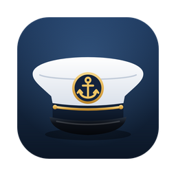
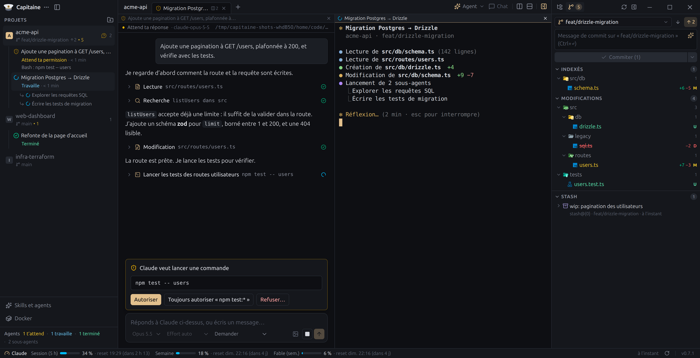
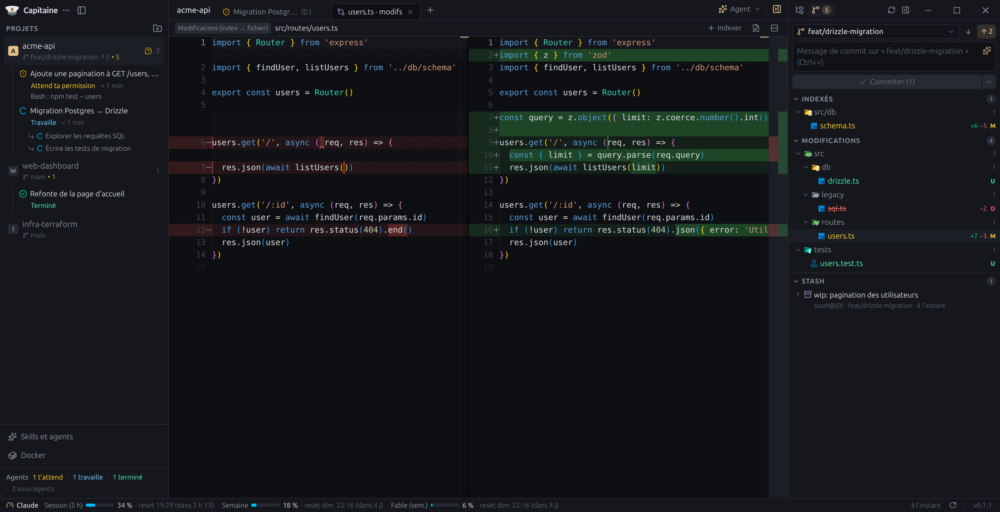

<div align="center">



# Capitaine

### Garde le cap sur tes agents IA.

**L'espace de travail pour piloter tes sessions Claude Code, projet par projet.**<br />
En chat ou en terminal, côte à côte, avec le statut de chaque agent en direct, les fichiers, git et ton quota dans la même fenêtre.

[](https://github.com/lucas-burlot/Capitaine/releases/latest)
[](LICENSE)
[](#-télécharger)
[](#-suivi-des-agents)
[](https://github.com/lucas-burlot/Capitaine/stargazers)

[**Télécharger**](#-télécharger) · [**Fonctionnalités**](#-fonctionnalités) · [**Raccourcis**](#%EF%B8%8F-raccourcis) · [**FAQ**](#-faq) · [**Développement**](#%EF%B8%8F-développement)

<br />



</div>

<br />

> **Trois agents qui travaillent, c'est trois fois plus d'onglets à surveiller.** Lequel a fini ? Lequel attend ta réponse depuis dix minutes ?
> Capitaine te le dit en un coup d'œil, et te prévient quand on a besoin de toi.

## ✨ Fonctionnalités

### 💬 Claude en chat ou dans un terminal

Ouvre Claude **en chat** : ses réponses en Markdown, ses outils repliés (commandes, diffs, todos, sous-agents), les images collées, les fichiers glissés avec `@` et les commandes `/` en autocomplétion. Tu choisis le modèle, l'effort et le mode d'autorisation depuis le composer.

Tu préfères le terminal ? Lance Claude **dans un terminal**, comme d'habitude. Un raccourci fait passer une conversation de l'un à l'autre sans perdre le contexte : c'est la même session Claude, reprise avec `--resume`.

### 🛡️ Les autorisations sous les yeux

Quand Claude veut lancer une commande ou modifier un fichier, le chat te montre la commande ou le diff : **Autoriser**, **Toujours autoriser** pour la conversation, ou **Refuser** en lui disant quoi faire à la place. Ses questions et ses plans s'affichent en cartes à remplir ou à approuver.

### 🧭 Tous tes agents en un coup d'œil

Sous chaque projet, tes sessions Claude (chats et terminaux) avec leur statut en direct : *Travaille*, *Attend ta réponse*, *Attend ta permission*, *Terminé*. Leurs **sous-agents** sont listés en dessous, et la question en attente est affichée. Une **notification système** te prévient quand un agent t'attend ou a fini, sauf si tu le regardes déjà.

### 🪟 Côte à côte, et rien ne se perd

Des onglets par projet, à diviser à droite ou en bas autant que tu veux. Les agents continuent de travailler quand tu changes d'onglet ou de projet. Ferme l'app : à la réouverture, tes onglets reviennent, chaque terminal dans son dossier avec son historique, et chaque conversation Claude reprend là où elle en était.

### 🔀 Git, de la branche au push

Ce que l'agent a changé, rangé par dossiers, avec les lignes ajoutées et supprimées et le **diff en un clic**. Change de branche, indexe, commite, pousse, récupère et range tes changements dans un stash sans quitter l'app. Le ✨ fait **écrire le message de commit par Claude**, et en cas de conflit, Claude propose une résolution que tu relis avant de l'accepter.

<div align="center">
<br />

<sub><b>Ce que l'agent a changé, ligne par ligne.</b> Un clic dans le panneau Git.</sub>
<br /><br />
</div>

### Et aussi

- **📝 Éditeur intégré** : Monaco, l'éditeur de VS Code. Il se recharge quand un agent modifie le fichier ouvert, colore aussi Vue, Svelte, `.env`, TOML et Makefile, et propose un aperçu Markdown côte à côte.
- **🌳 Explorateur de fichiers** : coloré selon git, avec une icône par langage. Retrouve un fichier en tapant quelques lettres de son nom, et glisse-le dans un terminal ou un chat pour le donner à Claude.
- **🧩 Skills et agents** : les skills, agents, commands, rules et `CLAUDE.md` que Claude Code charge pour le projet, qu'ils viennent du projet, de `~/.claude` ou de tes plugins, avec leur contenu et un clic pour les ouvrir.
- **🐳 Docker** : les conteneurs du projet en premier, avec démarrer, arrêter, ouvrir un port et leurs logs en direct.
- **📊 Ton quota Claude** : la session de 5 h, la semaine et les quotas par modèle, avec l'heure de remise à zéro, toujours en bas de la fenêtre.
- **🔄 Mises à jour** : une carte annonce chaque nouvelle version avec ses nouveautés, et tu choisis quand l'installer.

## 📥 Télécharger

| Plateforme | Fichier |
| :--- | :--- |
| 🍏 **macOS** · Apple Silicon (M1 et plus) | [**Capitaine-mac-arm64.dmg**](https://github.com/lucas-burlot/Capitaine/releases/latest/download/Capitaine-mac-arm64.dmg) |
| 🍏 **macOS** · Intel | [**Capitaine-mac-x64.dmg**](https://github.com/lucas-burlot/Capitaine/releases/latest/download/Capitaine-mac-x64.dmg) |
| 🪟 **Windows** 10 / 11 | [**Capitaine-win-x64.exe**](https://github.com/lucas-burlot/Capitaine/releases/latest/download/Capitaine-win-x64.exe) |
| 🐧 **Linux** | [**.deb**](https://github.com/lucas-burlot/Capitaine/releases/latest/download/capitaine-linux-amd64.deb) (Ubuntu, Debian) · [**AppImage**](https://github.com/lucas-burlot/Capitaine/releases/latest/download/Capitaine-linux-x86_64.AppImage) |

Il te faut [Claude Code](https://claude.com/claude-code) 2.1.295 ou plus, déjà connecté. Toutes les versions et leurs notes sont dans les [**Releases**](https://github.com/lucas-burlot/Capitaine/releases).

<details>
<summary><b>⚠️ Premier lancement : les applications ne sont pas encore signées</b></summary>

<br />

Capitaine n'a pas (encore) de certificat Apple ou Microsoft, donc ton système te prévient la première fois :

- **macOS** : glisse Capitaine dans *Applications*. Au premier lancement, ouvre *Réglages Système → Confidentialité et sécurité* et clique sur **Ouvrir quand même** (ou lance une fois `xattr -dr com.apple.quarantine /Applications/Capitaine.app`).
- **Windows** : sur *« Windows a protégé votre ordinateur »*, clique sur **Informations complémentaires → Exécuter quand même**.
- **Linux** : `sudo apt install ./capitaine-linux-amd64.deb`. Sur Ubuntu, préfère le `.deb` à l'AppImage : son installation configure le sandbox de Chromium.

</details>

## 🚀 Démarrage rapide

1. **Ajoute un projet** avec le bouton 📁+ de la barre latérale.
2. **Clique sur *Agent*** (<kbd>⌘</kbd> <kbd>N</kbd> / <kbd>Ctrl</kbd> <kbd>Shift</kbd> <kbd>N</kbd>). Claude s'ouvre en chat ou dans un terminal, selon ce que tu as choisi dans le menu du bouton.
3. **Écris ta demande.** La session apparaît sous le projet, avec son statut. 🎉

Divise l'onglet pour lancer un deuxième agent à côté, et ouvre le panneau de droite pour suivre les fichiers et les changements git.

## 🧭 Suivi des agents

Aucun hook ni aucune configuration. **En chat**, Capitaine lit directement le flux de Claude. **Dans un terminal**, Claude Code annonce son état au terminal qui l'héberge via le *Program Status Protocol* (OSC 7501), et Capitaine le lit.

| Ce que fait Claude | Ce que tu vois |
| :--- | :--- |
| Travaille sur ta demande | ⟳ **Travaille**, et depuis combien de temps |
| Lance des sous-agents | ↳ un sous-agent par ligne, sous la session |
| Te pose une question | ❓ **Attend ta réponse**, avec la question |
| Demande une permission | 🛡️ **Attend ta permission**, avec la commande ou le fichier |
| A fini son tour | ✅ **Terminé** |

Les autres agents qui parlent le même protocole (OSC 7501) apparaissent aussi dans la liste.

## ⌨️ Raccourcis

| Action | macOS | Windows / Linux |
| :--- | :---: | :---: |
| Nouvel agent Claude | <kbd>⌘</kbd> <kbd>N</kbd> | <kbd>Ctrl</kbd> <kbd>Shift</kbd> <kbd>N</kbd> |
| Basculer l'agent entre chat et terminal | <kbd>⌘</kbd> <kbd>⇧</kbd> <kbd>M</kbd> | <kbd>Ctrl</kbd> <kbd>Shift</kbd> <kbd>M</kbd> |
| Nouvel onglet | <kbd>⌘</kbd> <kbd>T</kbd> | <kbd>Ctrl</kbd> <kbd>Shift</kbd> <kbd>T</kbd> |
| Fermer le panneau ou l'onglet | <kbd>⌘</kbd> <kbd>W</kbd> | <kbd>Ctrl</kbd> <kbd>Shift</kbd> <kbd>W</kbd> |
| Diviser à droite / en bas | <kbd>⌘</kbd> <kbd>D</kbd> / <kbd>⌘</kbd> <kbd>⇧</kbd> <kbd>D</kbd> | <kbd>Ctrl</kbd> <kbd>Shift</kbd> <kbd>D</kbd> / <kbd>E</kbd> |
| Panneau suivant / précédent | <kbd>⌘</kbd> <kbd>⌥</kbd> <kbd>→</kbd> / <kbd>←</kbd> | <kbd>Ctrl</kbd> <kbd>Alt</kbd> <kbd>→</kbd> / <kbd>←</kbd> |
| Onglet suivant / précédent | <kbd>⌘</kbd> <kbd>⇧</kbd> <kbd>]</kbd> / <kbd>[</kbd> | <kbd>Ctrl</kbd> <kbd>Tab</kbd> / <kbd>Ctrl</kbd> <kbd>Shift</kbd> <kbd>Tab</kbd> |
| Retrouver un fichier | <kbd>⌘</kbd> <kbd>P</kbd> | <kbd>Ctrl</kbd> <kbd>Shift</kbd> <kbd>P</kbd> |
| Ajouter un projet | <kbd>⌘</kbd> <kbd>O</kbd> | <kbd>Ctrl</kbd> <kbd>Shift</kbd> <kbd>O</kbd> |
| Barre latérale | <kbd>⌘</kbd> <kbd>⇧</kbd> <kbd>S</kbd> | <kbd>Ctrl</kbd> <kbd>Shift</kbd> <kbd>S</kbd> |
| Panneau de droite (fichiers, git) | <kbd>⌘</kbd> <kbd>B</kbd> | <kbd>Ctrl</kbd> <kbd>Shift</kbd> <kbd>B</kbd> |
| Aperçu Markdown | <kbd>⌘</kbd> <kbd>⇧</kbd> <kbd>V</kbd> | <kbd>Ctrl</kbd> <kbd>Shift</kbd> <kbd>V</kbd> |

Sur Windows et Linux, <kbd>Ctrl</kbd> + lettre reste au shell (<kbd>Ctrl</kbd> <kbd>C</kbd>, <kbd>Ctrl</kbd> <kbd>R</kbd>…), d'où les raccourcis en <kbd>Ctrl</kbd> <kbd>Shift</kbd>.

## 🔒 Confidentialité

- **Pas de serveur Capitaine**, ni compte ni télémétrie.
- **Claude passe par ta CLI Claude Code**, en chat comme en terminal : ton code part chez Anthropic exactement comme dans une session Claude Code, avec ta connexion.
- **Les fonctions IA du panneau Git** (message de commit, résolution de conflit) ne partent que quand tu cliques, via `claude -p` sans outils.
- **Le quota** est lu avec la connexion de Claude Code. Le jeton reste dans le processus principal et n'est envoyé qu'à `api.anthropic.com`.
- **Les mises à jour** n'interrogent que les releases GitHub de ce dépôt.

## ❓ FAQ

<details>
<summary><b>Faut-il configurer Claude Code ou installer des hooks ?</b></summary>
<br />
Non. Ouvre un agent, en chat ou en terminal : la session apparaît toute seule. Il faut Claude Code 2.1.295 ou plus récent.
</details>

<details>
<summary><b>Pourquoi certaines commandes <code>/</code> manquent dans le chat ?</b></summary>
<br />
Le chat propose les commandes que Claude Code accepte sans terminal. Celles qui ouvrent leurs propres menus (<code>/plugin</code>, <code>/login</code>…) n'en font pas partie : bascule l'agent en terminal (<kbd>⌘</kbd> <kbd>⇧</kbd> <kbd>M</kbd>), lance-les, puis reviens au chat.
</details>

<details>
<summary><b>Et les autres agents (Codex, Aider…) ?</b></summary>
<br />
Ils fonctionnent comme dans n'importe quel terminal. Ceux qui annoncent leur état par le protocole OSC 7501 apparaissent aussi dans la liste.
</details>

<details>
<summary><b>Où sont enregistrés mes projets ?</b></summary>
<br />
Dans <code>~/.config/Capitaine</code> (Linux), <code>~/Library/Application Support/Capitaine</code> (macOS) ou <code>%APPDATA%\Capitaine</code> (Windows).
</details>

<details>
<summary><b>L'interface existe-t-elle en anglais ?</b></summary>
<br />
Pas encore : elle est en français pour l'instant.
</details>

## 🛠️ Développement

Il faut [Node.js](https://nodejs.org) 22 ou plus, et sur Linux `python3`, `make` et `g++` pour compiler `node-pty`.

```bash
git clone https://github.com/lucas-burlot/Capitaine.git
cd Capitaine
npm install
npm run dev                                    # l'app, avec rechargement à chaud
npm run typecheck                              # TypeScript, main + interface
npm run build && npm run smoke                 # test de bout en bout, sans fenêtre (Linux)
npm run build && node scripts/screenshots.mjs  # régénère les images du README
```

`node scripts/fake-agent.mjs`, lancé dans un terminal de Capitaine, rejoue les statuts de Claude Code sans consommer de tokens.

**Ubuntu 23.10 et plus** : si `npm run dev` échoue avec *« The SUID sandbox helper binary was found, but is not configured correctly »*, lance `sudo chown root:root node_modules/electron/dist/chrome-sandbox && sudo chmod 4755 node_modules/electron/dist/chrome-sandbox` (à refaire après chaque réinstallation d'Electron).

<details>
<summary><b>Architecture</b></summary>

<br />

Electron, React et TypeScript, sur le même socle qu'[Orca](https://github.com/stablyai/orca) : xterm.js, node-pty et Monaco. Le code est rangé par fonctionnalité, avec les mêmes domaines côté processus principal et côté interface :

```
src/
├── shared/types/   Types partagés (api.ts : le contrat window.capitaine)
├── preload/        Le pont window.capitaine
├── main/           Processus principal : projects, terminals, files, git, claude, docker, updater
└── renderer/src/   Interface React : app/ (cadre de la fenêtre), features/, ui/, lib/
```

| Fichier | Rôle |
| :--- | :--- |
| [`src/main/claude/claude-chat.ts`](src/main/claude/claude-chat.ts) | Claude en chat : un `claude -p` en stream-json par conversation |
| [`src/renderer/src/features/chat/chat-fold.ts`](src/renderer/src/features/chat/chat-fold.ts) | Le flux de Claude transformé en messages, outils et tours |
| [`src/renderer/src/features/claude/agent-status.ts`](src/renderer/src/features/claude/agent-status.ts) | Le parseur OSC 7501 et le modèle session / sous-agents |
| [`src/renderer/src/features/workspace/workspace-store.ts`](src/renderer/src/features/workspace/workspace-store.ts) | Projets, onglets, panneaux, agents |
| [`src/main/terminals/pty-manager.ts`](src/main/terminals/pty-manager.ts) | Les shells (node-pty) |
| [`src/main/git/`](src/main/git) | Statut, actions git et fonctions IA du panneau Git |

</details>

**Publier une version** : `npm run release:patch` (ou `release:minor`) augmente la version, crée le tag `vX.Y.Z` et le pousse. [GitHub Actions](.github/workflows/release.yml) construit alors l'app pour les trois plateformes et publie la release.

Les contributions sont les bienvenues : vérifie que `npm run typecheck` et `npm run smoke` passent, puis ouvre une pull request. Une idée ou un bug ? [Ouvre une issue](https://github.com/lucas-burlot/Capitaine/issues).

<div align="center">

<br />

**Si Capitaine t'aide à garder le cap, une ⭐ aide d'autres à le trouver.**

<sub>Licence MIT · Fait par <a href="https://github.com/lucas-burlot">Lucas Burlot</a> · Inspiré d'<a href="https://github.com/stablyai/orca">Orca</a></sub>

</div>
